# 골목픽 (Golmok Pick)

> **공강 시간 안에 닿는 골목 가게를 찾아드려요**
> 광운대생과 학교 앞 상권을 잇는 AI 상권 큐레이션 서비스 — 2026 광운 탐구 모임 · **노원로그**

| 팀 | 팀원 | 활용 데이터 |
|---|---|---|
| 노원로그 | 이지우 · 이현진 · 홍세은 · 김보경 · 최서린 | HeyYumi API · 서울시 상권분석서비스 |

---

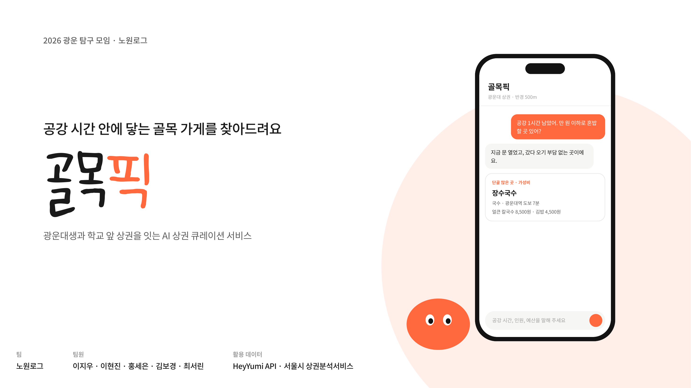

> 이 README의 1~2장은 발표 자료(`docs/slides/`)를 장마다 캡처하고, 각 장이 말하는 내용과 그 의미를 풀어 쓴 거예요.

**목차**
[01 배경](#01-배경--왜-노원구-왜-광운대일까) · [02 통계 분석](#02-통계-분석--지나가지만-쓰지는-않아요) · [03 문제 정의](#03-문제-정의) · [04 페르소나](#04-페르소나) · [05 How Might We](#05-how-might-we) · [06 솔루션](#06-솔루션--골목픽) · [07 프로토타입 시나리오](#07-프로토타입-시나리오) · [08 기대효과](#08-기대효과) · [실행하기](#3-프로토타입-실행하기-각자-로컬에서)

---

## 1. 분석과 문제 정의

### 01 배경 — 왜 노원구, 왜 광운대일까?

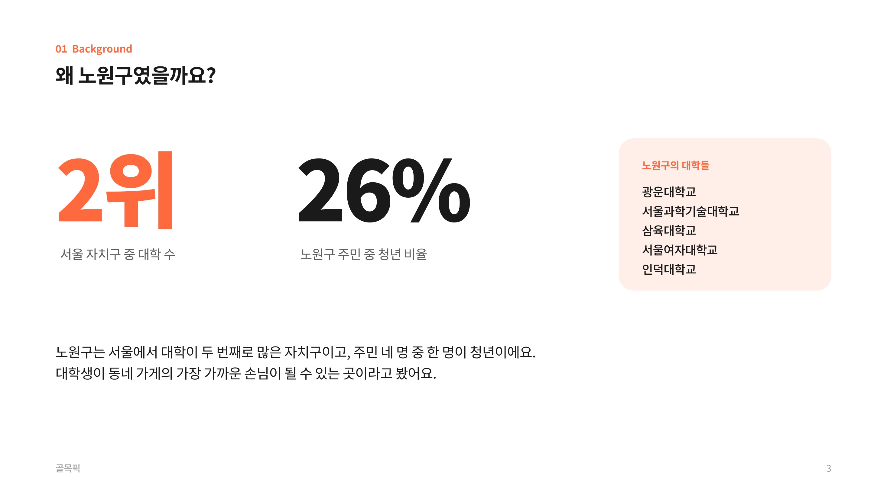

**노원구는 서울 자치구 중 대학 수 2위, 주민 4명 중 1명(26%)이 청년이에요.**
광운대·서울과기대·삼육대·서울여대·인덕대가 모여 있어서, 대학생이 동네 가게의 *가장 가까운 손님*이 될 수 있는 지역이에요.
그래서 "대학생 ↔ 지역 상권" 연결 문제를 보기에 가장 적합한 곳으로 노원구를 골랐어요.

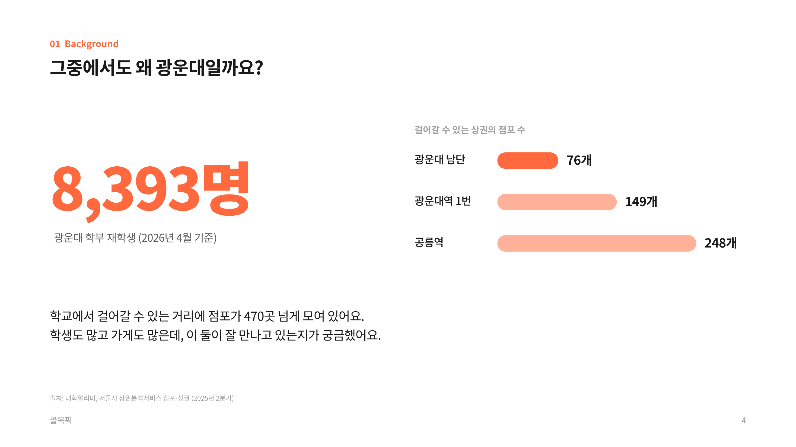

**광운대 학부 재학생은 8,393명(2026년 4월), 학교에서 걸어갈 수 있는 상권 점포는 470곳이 넘어요.**

| 상권 | 점포 수 |
|---|---|
| 광운대 남단 | 76개 |
| 광운대역 1번 | 149개 |
| 공릉역 | 248개 |

학생(수요)도 많고 가게(공급)도 많아요. 그래서 질문은 **"이 둘이 실제로 잘 만나고 있나?"** 로 좁혀져요.
<sub>출처: 대학알리미, 서울시 상권분석서비스 점포-상권 (2025년 2분기)</sub>

---

### 02 통계 분석 — 지나가지만, 쓰지는 않아요

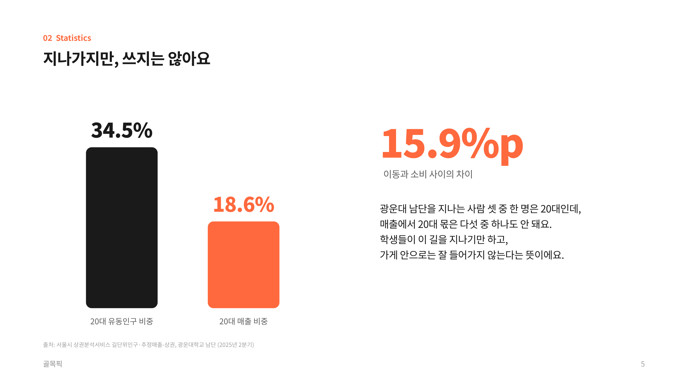

| 지표 (광운대 남단, 2025 Q2) | 값 |
|---|---|
| 20대 유동인구 비중 | **34.5%** |
| 20대 매출 비중 | **18.6%** |
| 차이 | **15.9%p** |

**해석.** 남단을 지나는 사람 셋 중 한 명이 20대인데, 매출에서 20대 몫은 다섯 중 하나도 안 돼요.
20대가 **지나가는 만큼 쓰고 있지 않다**는 뜻이에요. 다시 말해 학생들이 이 길을 *통로*로만 쓰고 가게 안으로는 잘 들어가지 않아요.
→ 수요가 없는 게 아니라 **이미 지나가는 수요가 소비로 바뀌지 않는 것**이 문제예요.

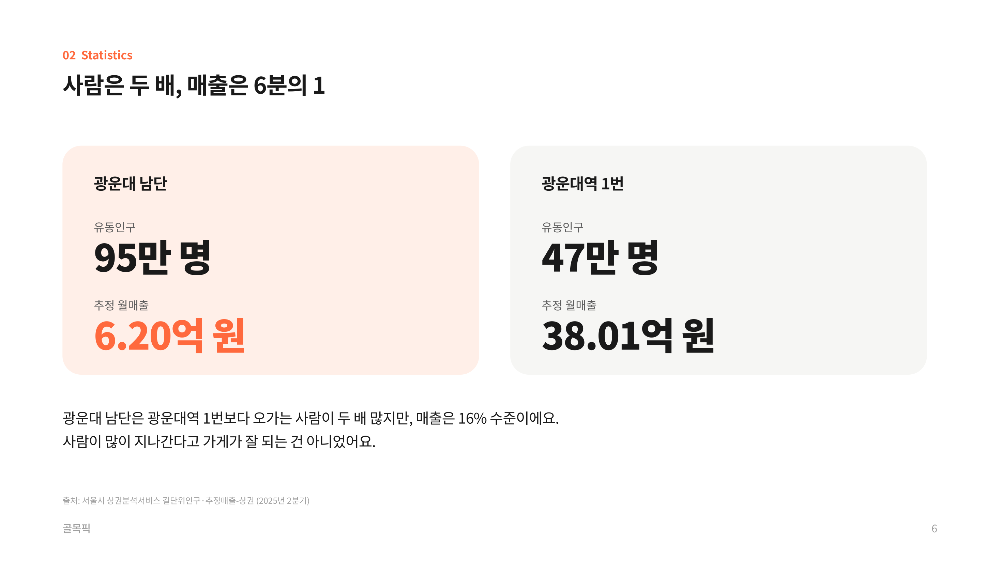

| | 광운대 남단 | 광운대역 1번 |
|---|---|---|
| 유동인구 | **95만 명** | 47만 명 |
| 추정 월매출 | **6.20억 원** | 38.01억 원 |

**해석.** 남단은 광운대역 1번보다 사람이 **2배** 많이 다니는데, 매출은 **16% 수준**(약 6분의 1)이에요.
유동인구 1명당 매출로 보면 차이가 12배 넘게 벌어져요 (월 기준 남단 약 650원 vs 역 1번 약 8,100원).
→ "사람이 많이 지나가면 가게가 잘 된다"는 가정이 이 상권에서는 맞지 않아요. **유입(동선)과 전환(가게 방문) 사이에 막힌 지점**이 있다는 신호예요.

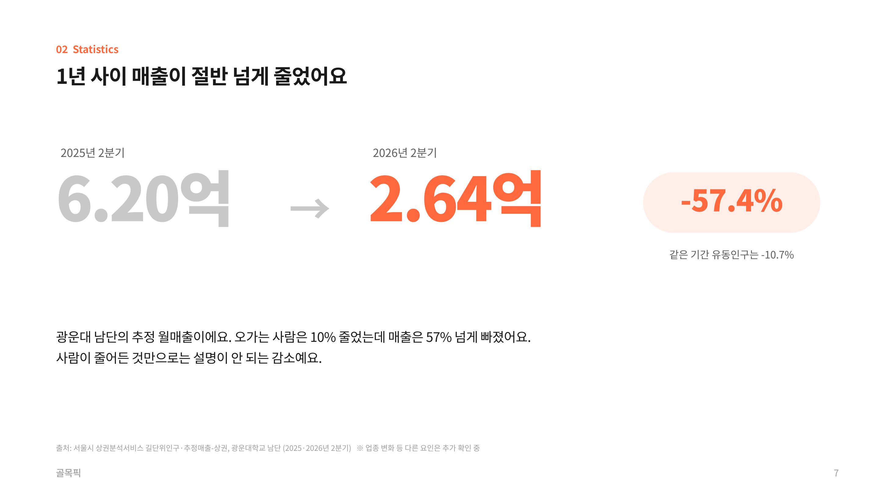

| 광운대 남단 | 2025 Q2 | 2026 Q2 | 변화 |
|---|---|---|---|
| 추정 월매출 | 6.20억 | 2.64억 | **-57.4%** |
| 유동인구 | | | -10.7% |

**해석.** 사람은 10% 줄었는데 매출은 57% 넘게 빠졌어요. 사람이 줄어든 것만으로는 설명이 안 되는 감소예요.
→ 남단 상권은 이미 *빠르게 약해지는 중*이고, 학생을 다시 가게로 데려올 장치가 급해요.
<sub>※ 업종 변화 등 다른 요인은 추가 확인 중이에요. 이 감소가 전부 "정보 부족" 때문이라고 단정하지는 않아요.</sub>

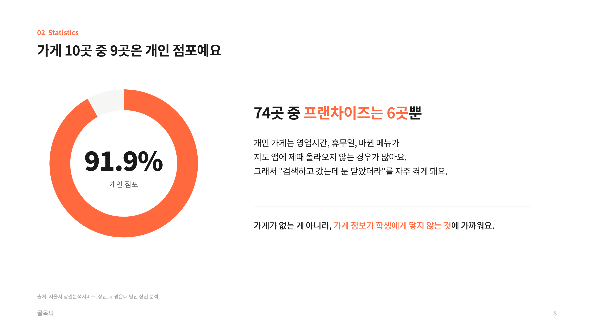

**남단 점포 74곳 중 프랜차이즈는 6곳뿐, 개인 점포가 91.9%예요.**
개인 가게는 영업시간·휴무일·바뀐 메뉴가 지도 앱에 제때 올라오지 않는 경우가 많아요. 그래서 학생들은 "검색하고 갔는데 문 닫았더라"를 자주 겪고, 결국 정보가 확실한 프랜차이즈나 늘 가던 곳으로 가요.
→ **가게가 없는 게 아니라, 가게 정보가 학생에게 닿지 않는 것**에 가까워요.

#### 분석 요약

| 관찰 | 의미 |
|---|---|
| 20대 유동 34.5% vs 매출 18.6% | 학생은 지나가지만 소비하지 않음 |
| 남단 유동 2배인데 매출은 1/6 | 유입은 충분하고 전환에서 막힘 |
| 1년간 매출 -57% (유동 -11%) | 상권이 빠르게 약해지는 중 |
| 개인 점포 91.9% | 정보 갱신이 느려 신뢰도가 낮음 |

---

### 03 문제 정의

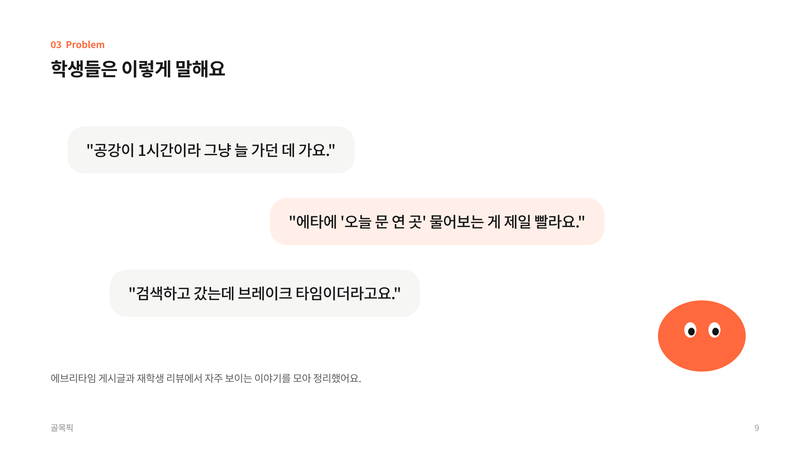

에브리타임 게시글과 재학생 리뷰에서 자주 보이는 이야기를 모았어요.

| 학생의 말 | 숨은 원인 |
|---|---|
| "공강이 1시간이라 그냥 늘 가던 데 가요." | **시간** — 새 가게를 시도할 여유가 없음 |
| "에타에 '오늘 문 연 곳' 물어보는 게 제일 빨라요." | **정보 채널** — 믿을 만한 최신 정보 창구가 없음 |
| "검색하고 갔는데 브레이크 타임이더라고요." | **정보 정확도** — 지도 앱 정보가 실제와 다름 |

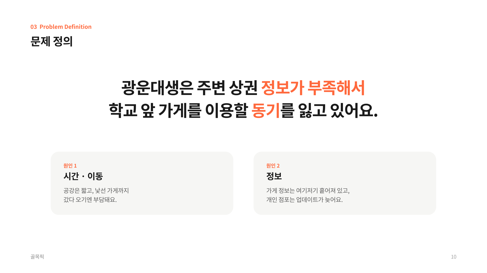

> ### 광운대생은 주변 상권 **정보가 부족해서** 학교 앞 가게를 이용할 **동기**를 잃고 있어요.

| | 원인 1 · 시간·이동 | 원인 2 · 정보 |
|---|---|---|
| 내용 | 공강은 짧고, 낯선 가게까지 갔다 오기엔 부담돼요. | 가게 정보는 여기저기 흩어져 있고, 개인 점포는 업데이트가 늦어요. |
| 근거 | "늘 가던 데 가요", 짧은 공강 | 개인 점포 91.9%, "갔더니 브레이크 타임" |
| 결과 | 실패 비용(시간 낭비)이 커서 새 가게를 시도하지 않음 | 정보를 믿지 못해 탐색 자체를 포기 |

**정리하면:** 통계(02)는 "학생이 지나가지만 쓰지 않는다"는 *현상*을, 학생 목소리(03)는 그 이유가 *시간 부담 + 못 믿을 정보*라는 걸 보여줘요.
그래서 해결책은 가게를 새로 만드는 게 아니라, **"지금 내 공강 안에 갈 수 있고, 믿을 수 있는 가게"를 바로 알려주는 것**이어야 해요.

---

### 04 페르소나

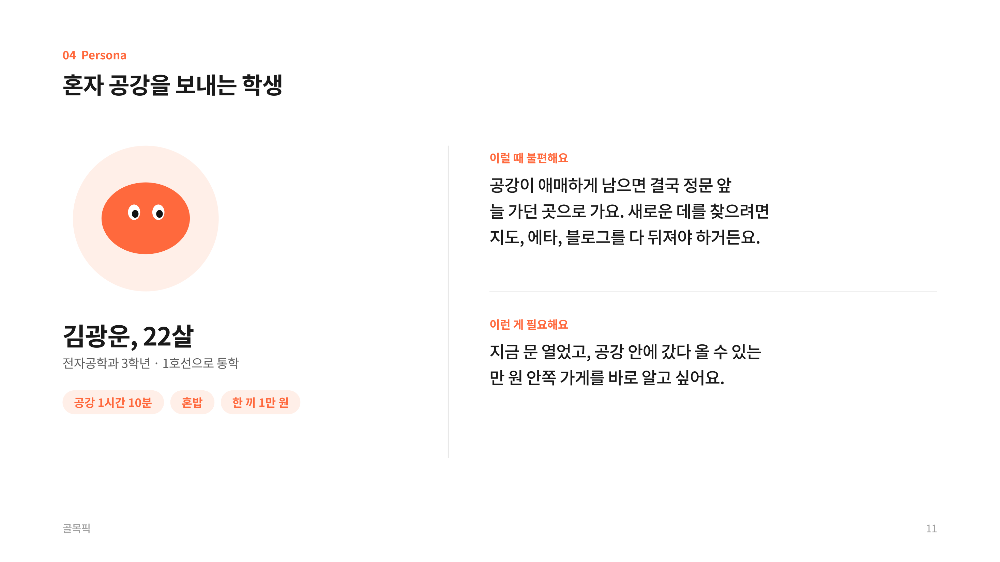

**김광운 (22) · 전자공학과 3학년 · 1호선 통학**
- 조건: 공강 **1시간 10분**, **혼밥**, 한 끼 **1만 원**
- 불편: 공강이 애매하게 남으면 결국 정문 앞 늘 가던 곳으로 가요. 새 데를 찾으려면 지도·에타·블로그를 다 뒤져야 해요.
- 필요: **지금 문 열었고, 공강 안에 갔다 올 수 있는 만 원 안쪽 가게**를 바로 알고 싶어요.
- → 원인 1(시간)이 가장 큰 사용자. 앱에서는 *공강 시간 → 도보 거리 필터*로 대응해요.

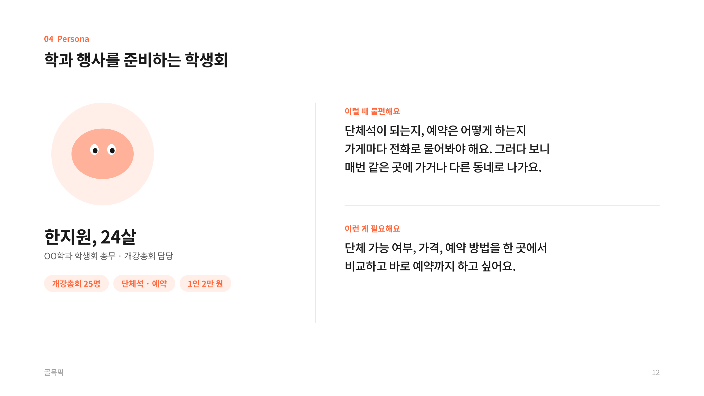

**한지원 (24) · OO학과 학생회 총무 · 개강총회 담당**
- 조건: 개강총회 **25명**, 단체석, 예약, 1인 **2만 원**
- 불편: 단체석이 되는지, 예약은 어떻게 하는지 가게마다 전화로 물어봐야 해요. 그러다 보니 매번 같은 곳에 가거나 다른 동네로 나가요.
- 필요: **단체 가능 여부, 가격, 예약 방법을 한 곳에서 비교하고 바로 예약**까지.
- → 원인 2(정보)가 가장 큰 사용자. 앱에서는 *단체 가능 필터 + 채팅 속 예약 요청*으로 대응해요.

---

### 05 How Might We

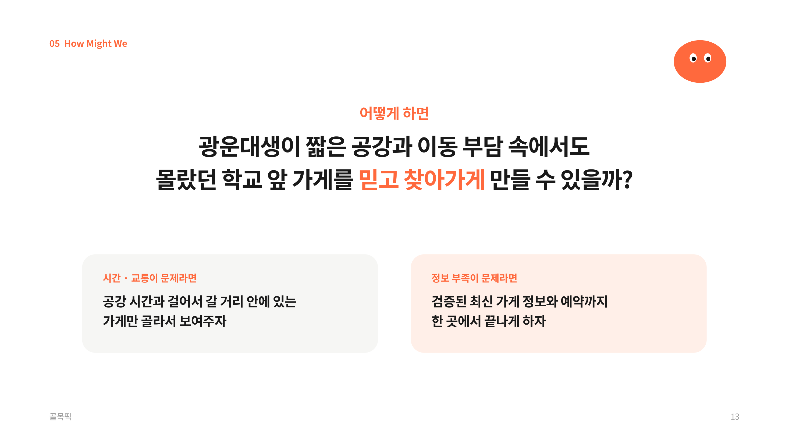

> 어떻게 하면 광운대생이 짧은 공강과 이동 부담 속에서도 **몰랐던 학교 앞 가게를 믿고 찾아가게** 만들 수 있을까?

| 문제 | 해결 방향 | 프로토타입 기능 |
|---|---|---|
| 시간·교통 | 공강 시간과 걸어서 갈 거리 안에 있는 가게만 골라서 보여주자 | 공강 시간 파싱 → 편도 도보 시간 계산 → 필터 |
| 정보 부족 | 검증된 최신 가게 정보와 예약까지 한 곳에서 끝나게 하자 | HeyYumi 교차 검증 데이터 + 예약 요청 버튼 |

---

## 2. 솔루션

### 06 솔루션 — 골목픽

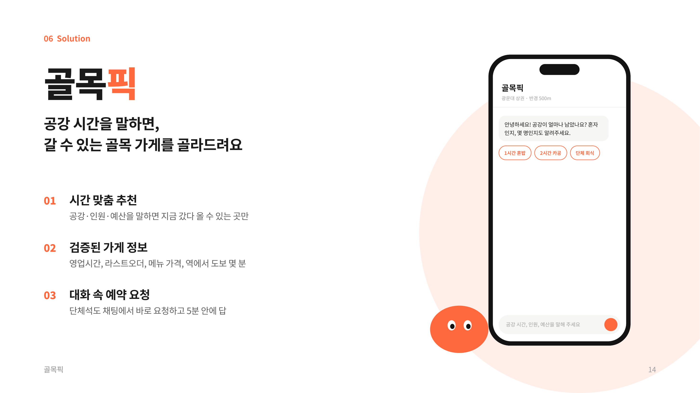

**공강 시간을 말하면, 갈 수 있는 골목 가게를 골라드려요.**

1. **시간 맞춤 추천** — 공강·인원·예산을 말하면 지금 갔다 올 수 있는 곳만
2. **검증된 가게 정보** — 영업시간, 라스트오더, 메뉴 가격, 역에서 도보 몇 분
3. **대화 속 예약 요청** — 단체석도 채팅에서 바로 요청하고 5분 안에 답

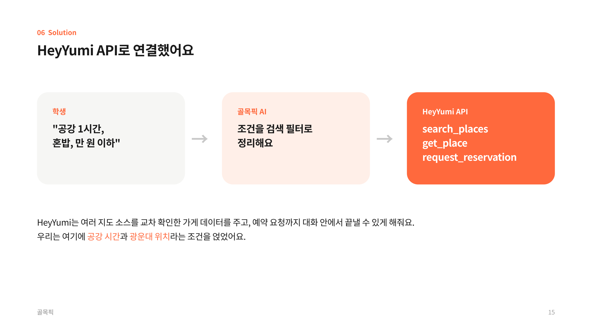

```
학생: "공강 1시간, 혼밥, 만 원 이하"
   │
   ▼
골목픽 AI (Claude) ── 조건을 검색 필터로 정리
   │
   ▼
HeyYumi API ── search_places · get_place · request_reservation
   │            (여러 지도 소스를 교차 확인한 가게 데이터 + 예약 요청)
   ▼
"지금 문 열었고, 갔다 오기 부담 없는 곳이에요" + 가게 카드
```

HeyYumi는 여러 지도 소스를 교차 확인한 가게 데이터를 주고, 예약 요청까지 대화 안에서 끝낼 수 있게 해줘요.
골목픽은 여기에 **공강 시간**과 **광운대 위치**라는 조건을 얹었어요.

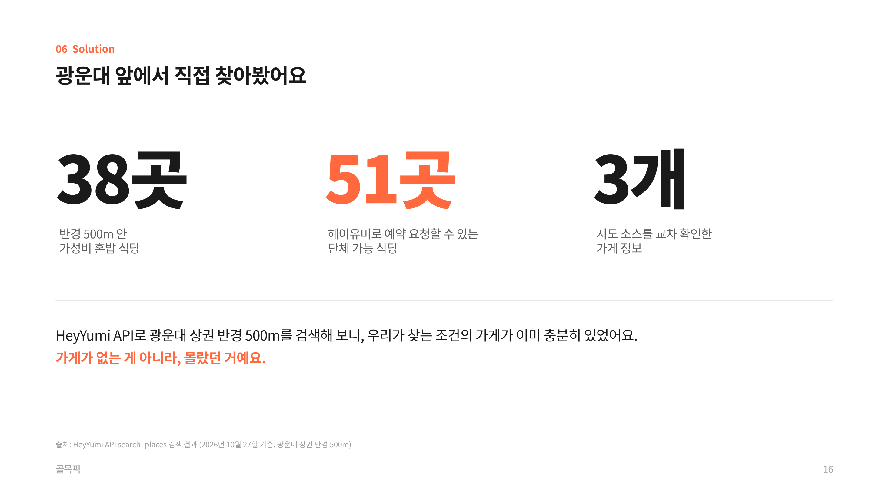

| HeyYumi 검색 결과 (광운대 상권, 2026-10-27) | |
|---|---|
| 반경 500m 안 가성비 혼밥 식당 | **38곳** |
| 헤이유미로 예약 요청할 수 있는 단체 가능 식당 | **51곳** |
| 가게 정보를 교차 확인한 지도 소스 | **3개** |

→ 조건에 맞는 가게는 이미 충분히 있어요. **가게가 없는 게 아니라, 몰랐던 거예요.** 03의 문제 정의(정보가 닿지 않음)를 데이터로 다시 확인한 셈이에요.

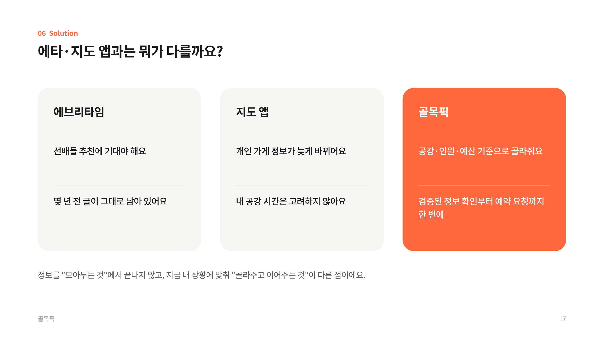

| | 에브리타임 | 지도 앱 | **골목픽** |
|---|---|---|---|
| 정보 출처 | 선배들 추천에 기댐 | 가게가 직접 올림 | 여러 지도 소스 교차 확인 |
| 최신성 | 몇 년 전 글이 그대로 | 개인 가게는 늦게 바뀜 | 검증된 최신 정보 |
| 내 상황 반영 | ✕ | 공강 시간 고려 안 함 | **공강·인원·예산 기준으로 골라줌** |
| 예약 | ✕ | 전화 | **채팅에서 예약 요청** |

정보를 *모아두는 것*에서 끝나지 않고, 지금 내 상황에 맞춰 **골라주고 이어주는 것**이 다른 점이에요.

---

### 07 프로토타입 시나리오

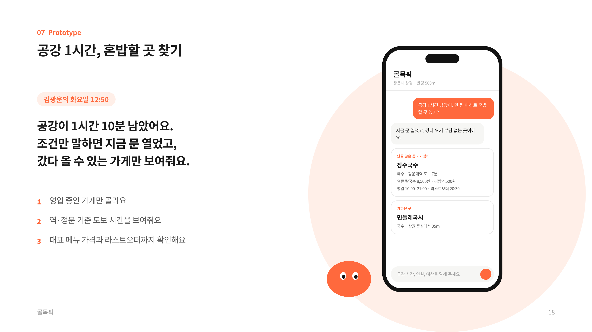

**시나리오 1 · 김광운의 화요일 12:50 — 공강 1시간 10분, 혼밥**
1. 영업 중인 가게만 골라요
2. 역·정문 기준 도보 시간을 보여줘요
3. 대표 메뉴 가격과 라스트오더까지 확인해요

→ 이 저장소의 프로토타입에서 `1시간 혼밥` 버튼을 누르면 그대로 재현돼요.

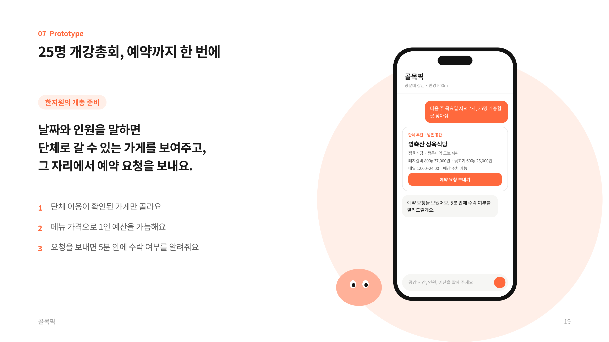

**시나리오 2 · 한지원의 개총 준비 — 다음 주 목요일 저녁 7시, 25명**
1. 단체 이용이 확인된 가게만 골라요
2. 메뉴 가격으로 1인 예산을 가늠해요
3. 요청을 보내면 5분 안에 수락 여부를 알려줘요

→ 프로토타입에서 `단체 회식` 버튼 → 카드의 **예약 요청 보내기**로 재현돼요.

---

### 08 기대효과

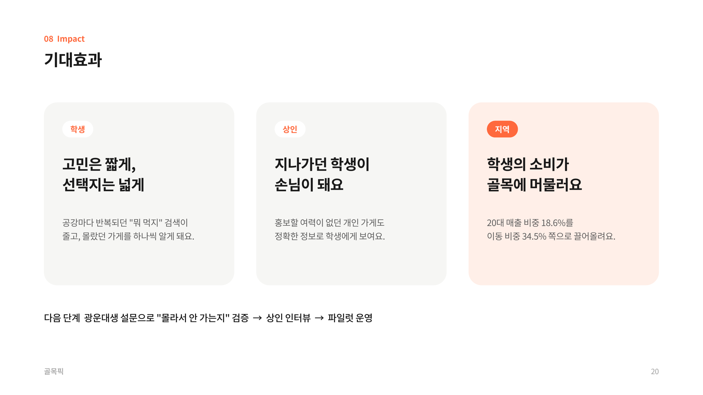

| 대상 | 효과 | 설명 |
|---|---|---|
| 학생 | 고민은 짧게, 선택지는 넓게 | 공강마다 반복되던 "뭐 먹지" 검색이 줄고, 몰랐던 가게를 하나씩 알게 돼요. |
| 상인 | 지나가던 학생이 손님이 돼요 | 홍보할 여력이 없던 개인 가게도 정확한 정보로 학생에게 보여요. |
| 지역 | 학생의 소비가 골목에 머물러요 | 20대 매출 비중 18.6%를 이동 비중 34.5% 쪽으로 끌어올려요. |

**다음 단계:** 광운대생 설문으로 "몰라서 안 가는지" 검증 → 상인 인터뷰 → 파일럿 운영

---

## 3. 프로토타입 실행하기 (각자 로컬에서)

### 준비물
- [Node.js](https://nodejs.org) **20 이상** (`node -v` 로 확인)
- (선택) **Claude API 키** — https://console.anthropic.com → API Keys
- (선택) **HeyYumi 토큰** — HeyYumi 팀에서 발급

> 키가 하나도 없어도 **데모 모드**(샘플 데이터)로 바로 돌아가요.

### 설치 & 실행
```bash
git clone https://github.com/dlwldn4824/nowon-log.git
cd nowon-log
npm install
npm run setup     # API 키 입력 (엔터로 건너뛰기 가능)
npm start
```
브라우저에서 **http://localhost:3000** 접속.

### API 키 넣는 방법 (셋 중 아무거나)
1. **앱 화면에서** — 오른쪽 위 ⚙️ 버튼 → 키 붙여넣기 → 저장 (서버 재시작 필요 없음)
2. **터미널에서** — `npm run setup`
3. **직접 파일 수정** — `.env.example` 을 `.env` 로 복사한 뒤 값 입력

```env
ANTHROPIC_API_KEY=sk-ant-...
HEYYUMI_API_KEY=...
```

> 🔒 `.env` 는 `.gitignore` 에 들어 있어 **GitHub에 올라가지 않아요.** 키는 각자 컴퓨터에만 저장하고, 절대 코드나 카톡에 붙여넣지 마세요.
> 서버는 `127.0.0.1` 에만 열려서 같은 와이파이의 다른 기기에서는 설정 화면에 접근할 수 없어요.

### 키에 따라 바뀌는 모드
| Claude 키 | HeyYumi 토큰 | 모드 | 동작 |
|:-:|:-:|---|---|
| ❌ | ❌ | **데모** | 규칙 기반 조건 파싱 + 샘플 가게 |
| ✅ | ❌ | **Claude + 샘플** | Claude가 대화·추천 문장 생성, 가게는 샘플 |
| ❌ | ✅ | **HeyYumi** | 규칙 기반 조건 파싱 + 실제 HeyYumi 검색 |
| ✅ | ✅ | **Claude + HeyYumi** | 전체 기능 (실제 가게 + 실제 예약 요청) |

현재 모드는 화면 오른쪽 위 배지에 보여요.

### 데모 시나리오
- `공강 1시간 남았어. 만 원 이하로 혼밥할 곳 있어?` → 도보 거리 안의 가성비 가게
- `공강 2시간인데 카공할 카페 추천해줘` → 콘센트 있는 카페
- `다음 주 목요일 저녁 7시, 25명 개총할 곳 찾아줘` → 단체 가능 + **예약 요청 보내기** 버튼

> ⚠️ HeyYumi 토큰이 있을 때 **예약 요청 보내기**는 실제 가게에 알림이 가요. 테스트할 땐 샘플 가게(‘샘플’ 태그)나 데모 모드를 쓰세요.

---

## 4. 프로젝트 구조

```
.
├── server.js            # Express 서버: 화면 + /api/chat, /api/settings, /api/reserve
├── src/
│   ├── config.js        # .env 읽기/쓰기, 모드 판단
│   ├── claude.js        # Claude 대화 + search_places 도구 호출 루프
│   ├── heyyumi.js       # HeyYumi MCP 최소 클라이언트 (JSON-RPC over HTTP)
│   └── places.js        # 조건 파싱(공강·인원·예산), 도보 시간 계산, 샘플 데이터
├── public/              # 채팅 화면 (HTML/CSS/JS, 빌드 없음)
├── scripts/setup.js     # npm run setup — 키 입력 도우미
└── .env.example         # 환경 변수 예시 (복사해서 .env 로)
```

### 동작 방식
- **Claude 모델**: 기본 `claude-opus-5-5` (`.env` 의 `ANTHROPIC_MODEL` 로 변경 가능). 채팅 응답 속도를 위해 `effort: low` 사용.
- **도구 호출**: Claude는 `search_places` 도구만 쓰고, 서버가 그걸 HeyYumi(또는 샘플)로 실행해요.
- **예약은 사람이 누를 때만**: Claude는 예약을 직접 보내지 않아요. 가게 카드의 버튼 → 날짜·인원·연락처 입력 → 서버가 HeyYumi `request_reservation` 호출 → `wait_for_reservation` 으로 결과 확인.
- **도보 시간**: 광운대역 기준 거리 ÷ 70m/분. 공강 시간에서 식사 35분을 빼고 왕복이 되는 가게만 우선 보여줘요.

---

## 5. 개발 다음 단계
- [ ] 정문/남단 등 출발 지점 선택
- [ ] 실시간 영업 여부·라스트오더 표시
- [ ] 서울시 상권 데이터 대시보드

---

## 협업 가이드 (팀원용)
```bash
git pull                          # 작업 전 최신화
git checkout -b feat/기능이름      # 브랜치 만들어서 작업
git add . && git commit -m "feat: 설명"
git push -u origin feat/기능이름   # GitHub에서 Pull Request
```
- `.env`, `node_modules/` 는 커밋되지 않아요 (`.gitignore`).
- 샘플 가게 데이터는 `src/places.js` 의 `SAMPLE` 에서 수정해요.

<sub>데이터 출처: 서울시 상권분석서비스(길단위인구·추정매출·점포), 대학알리미, 상권.kr, HeyYumi API. 샘플 데이터의 메뉴·영업시간은 예시이며 실제와 다를 수 있어요.</sub>
